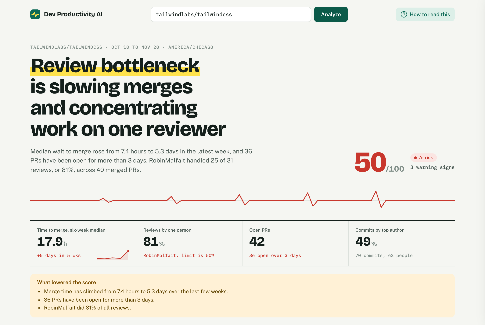
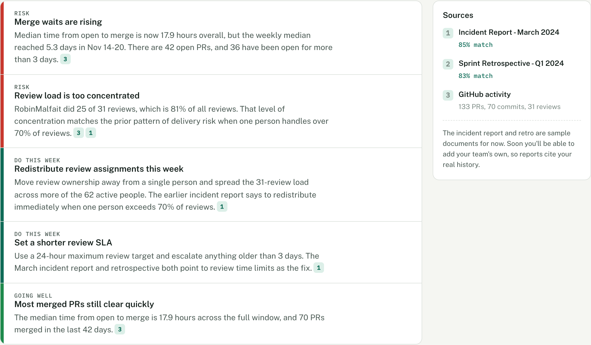
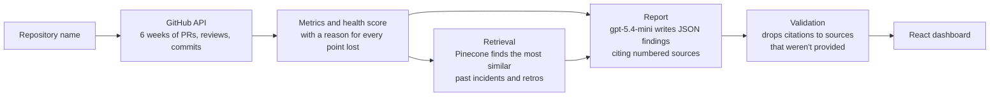
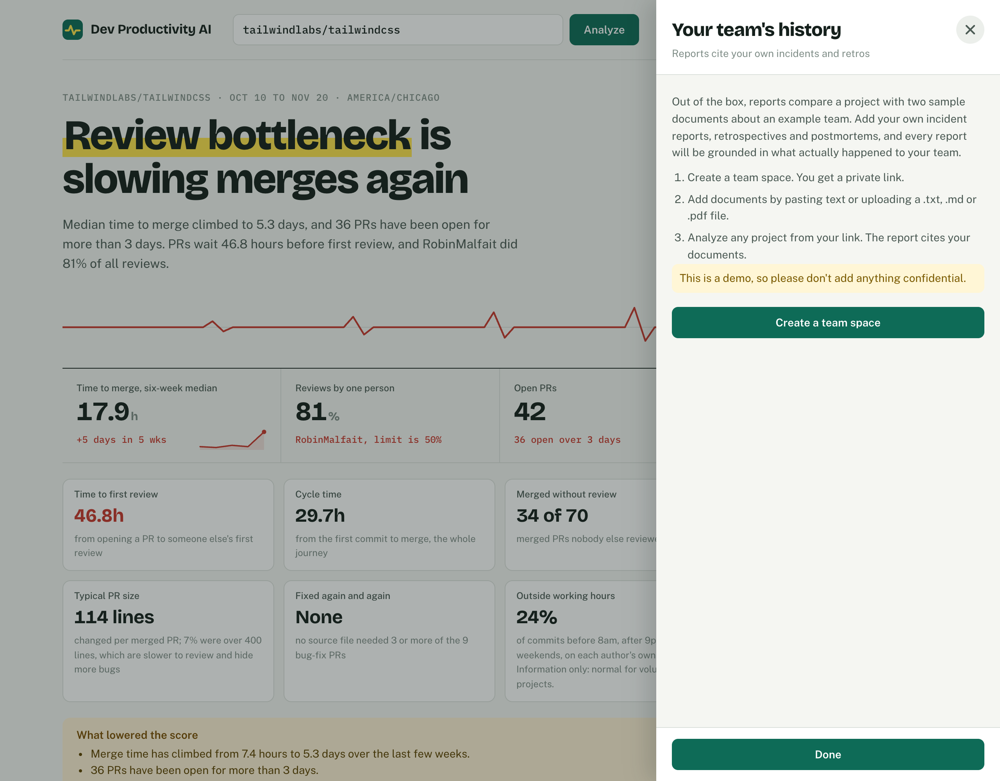

# Dev Productivity AI

Engineering teams rarely see trouble coming. Code waits days for review, one person quietly ends up reviewing everything, and the first anyone hears of it is a missed deadline or a burned-out teammate.

Dev Productivity AI reads a GitHub repository's last six weeks, finds those warning signs, and writes a short weekly report on what to do about them, with every recommendation linked to the past incident or retrospective it came from.

**Try it:** [dev-productivity-ai.vercel.app](https://dev-productivity-ai.vercel.app). Enter any public repository, for example `tailwindlabs/tailwindcss`.



---

## What it found in a real project

Analysis of `tailwindlabs/tailwindcss`, six weeks ending November 20, 2026:

- The typical wait to merge a pull request rose from **7.4 hours to 5.3 days** in the latest week.
- **36 pull requests** had been open for more than three days.
- **One maintainer did 25 of the last 31 reviews (81%).**

That combination, slow merges plus one overloaded reviewer, is the pattern the tool exists to catch. The report recommended spreading reviews across more people and setting a 24-hour review target, and cited the past incident each step came from:



Numbers like these change every week, and the live site always shows the current ones.

---

## How it works



1. **Collect.** The FastAPI backend pulls six weeks of pull requests, their reviews and the commits in one to three GitHub GraphQL requests, leaving out bots. (The first version used the REST API and needed up to 45 requests, one per PR's reviews.) The six weeks are aligned to the visitor's own time zone, so a PR merged at 7:30pm on October 11 in Oklahoma lands in the same week the visitor sees on GitHub.
2. **Measure.** It calculates the median time from opening a PR to merging it, week by week; the time to a first review by someone else; cycle time from first commit to merge; how many merged PRs nobody else reviewed; how many PRs are waiting for a first look or have been open for more than three days; how concentrated reviews and commits are; the typical PR size and share of very large PRs; source files changed by three or more bug-fix PRs, leaving out docs, release notes and tests that every fix touches; and the share of commits made before 8am, after 9pm or at weekends on each author's own clock, which is shown but never scored, since volunteers on open-source projects often work evenings.
3. **Score.** The score starts at 100 and loses points for each warning sign. Every deduction comes with a plain-language reason, so the score is never a black box.

   | Warning sign | Points |
   |---|---|
   | Typical wait over 24 hours / 2 days / a week | -12 / -25 / -35 |
   | Waits have doubled over recent weeks | -10 |
   | 2-4 / 5+ PRs open for more than 3 days | -8 / -15 |
   | One person does over 50% / 70% of reviews | -12 / -25 |
   | One person makes over 80% of commits | -10 |
   | PRs wait over 24 hours for a first review | -10 |
   | Over half of merged PRs had no review from anyone else | -10 |

   Solo projects aren't penalized for having one person do everything. Projects with very little activity are labelled "too little activity" instead of getting a misleading score, and projects that switch pull requests off, like the Linux kernel, are judged on commits alone.
4. **Retrieve.** The warning signs are embedded and searched against a Pinecone index of past incident reports and sprint retrospectives. Each match comes back with a similarity score that's shown to the user. A team can create a private team space and add its own incident reports, retros and postmortems (pasted, or as .txt, .md or .pdf files); each team gets its own Pinecone namespace, and reports run from the team's link search only that team's documents, marked "Your team's document".
5. **Generate.** The metrics, the reasons and the retrieved documents go to `gpt-5.4-mini`, which returns JSON: a headline, up to two risks, up to two actions and one thing going well, each citing numbered sources. The model is told to use only the numbers it's given.
6. **Validate.** The response is checked against the expected shape, and any citation pointing to a source that wasn't provided is removed. Every number in the report is then checked against the data and documents the model was given, so an invented or miscalculated figure is flagged on the page and in Langfuse.
7. **Track over time.** Visitors can track a project. A nightly GitHub Actions job then saves its score and key numbers to Supabase Postgres every day (no AI calls, so it's free), and the dashboard shows the score day by day plus plain comparisons with a month earlier ("Typical wait to merge is 30.5 hours, up from 14 hours last month").
8. **Email weekly.** From its team space, a team can subscribe to a project's report. The address must be confirmed by email first, and every Monday a GitHub Actions job writes one report per project and team (grounded in that team's documents) and emails it, with a one-click unsubscribe that deletes the address.
9. **Trace.** Every analysis is recorded in Langfuse as one trace: the history search, the embedding call and the report generation, each with its latency, token counts and cost, plus the final health score.

A "How to read this" panel in the app explains every number, chart and label in plain language. The layout also works on phones.

<p>
  
  
</p>

---

## Engineering decisions

| Decision | Why |
|---|---|
| Structured JSON reports instead of free text | The dashboard can render findings by type, and citations can be checked in code |
| A reason for every point deducted | Managers can see why the score moved, and disagree with it if they want |
| Time zone sent by the browser | Mixing UTC and local time moved PRs into the wrong week during testing |
| One-hour cache, a per-visitor hourly limit and a site-wide daily cap | Keeps API costs predictable on a public demo. Langfuse measures a report at about $0.0025 |
| History in Supabase, collected by a scheduled GitHub Action | Replaces the planned S3 and Lambda with free tools; the job uses only GitHub data and scoring, never the AI, and its daily run also keeps the free database from pausing |
| Weekly emails only from a team space, with double opt-in | The report names people. Offering it to anyone would let strangers monitor someone else's team every week, so it's for a team's own project, and nobody can be signed up without clicking a confirmation |
| A private team link instead of accounts | Teams can bring their own history in one click, recruiters can try it without signing up, and GitHub sign-in can be added on top later |
| One Pinecone namespace per team, and documents treated as reference only | Teams never see each other's documents, and a document containing instructions ("ignore your rules…") can't steer the report; this was tested with exactly such a document |
| Visitor ratings stored as Langfuse scores on the report's trace | Feedback survives redeploys (Render's disk doesn't) and sits next to the exact report it rates; names and emails go only to the owner's inbox |
| Langfuse tracing, switched off when keys are absent | Latency, tokens and cost per step are visible in production, while CI and fresh checkouts run without it |
| Exact library versions in `requirements.txt` | An unpinned dependency update is what originally broke the live site |
| First-commit times in a second, merged-only query | Asking for every PR's commits inside the main query doubled the fetch time (about 9.6s against 4.2s); a separate query for merged PRs adds about 1.2s |
| GitHub GraphQL instead of REST | One query returns PRs with their reviews; a busy repo went from 45 requests and 9.3s to 3 requests and 4.4s, with identical results |
| Read-only GitHub token scoped to public repositories | The least access the job needs |
| A scheduled health check every 10 minutes | Keeps the free Render server from sleeping, so visitors don't wait a minute for it to wake |

---

## Quality checks

Every push runs two checks in GitHub Actions:

- **Scoring tests** (`tests/test_metrics.py`) check the health score math on hand-built data with no API calls: solo projects, overloaded reviewers, duplicate reviews, quiet repositories and repositories without pull requests.
- **Upload tests** (`tests/test_team_docs.py`) check that team links are long and random, and that wrong file types, oversized files and broken PDFs get clear messages.
- **Number detector tests** (`tests/test_citation_check.py`) confirm the number check passes real figures and catches invented ones (a made-up "57%") and miscalculated ones ("6.1 days").
- **Report evaluation** (`tests/test_evaluation.py`) generates reports for a golden dataset of six team scenarios (an overloaded reviewer, a healthy team, a PR backlog, a solo maintainer, a nearly inactive repo and a project with pull requests switched off) and checks that each has a headline and the required finding types, raises no risks for a healthy team, cites only sources that exist, uses only numbers found in its inputs, and mentions the key topic. A second model then acts as a judge, reading each finding next to the sources it cites and deciding whether they support it. The build fails if fewer than 80% of reports pass or fewer than 90% of cited findings are supported.

  Adding the judge immediately caught real problems, each fixed in the prompt rather than by lowering the bar: a "risk" raised for a healthy team, an action citing an old incident for the team's current numbers, a past incident described as an "exact match", and a forced "going well" finding that claimed PRs were "on track" while three were stuck. After the fixes, consecutive runs pass 6 of 6 reports with every cited finding supported.

Before going live, the pipeline was also tested against twelve real projects, including `microsoft/vscode`, `facebook/react`, `django/django`, `torvalds/linux` and an archived repository. That testing found and fixed two bugs: repositories without pull requests were reported as missing, and nearly empty repositories scored a perfect 100.

---

## Tech stack

| Layer | Technology |
|---|---|
| Frontend | React and TypeScript, hand-drawn SVG charts, hosted on Vercel |
| Backend | Python 3.12, FastAPI, hosted on Render |
| Data | GitHub REST API |
| Retrieval | Pinecone serverless index, OpenAI `text-embedding-ada-002` embeddings through LangChain, LangChain text splitting |
| Generation | OpenAI `gpt-5.4-mini` with JSON output |
| History | Supabase Postgres, written by a nightly GitHub Actions job |
| Observability | Langfuse traces for each report (retrieval, embedding and generation steps) |
| CI | GitHub Actions: scoring tests, report evaluation, and the keep-awake job |

---

## Current limitations

These are honest gaps, and the next things on the roadmap.

- **Sample history by default.** Without a team space, reports compare a project with two example documents about a fictional team, and the dashboard labels them "Sample". Team spaces replace them with the team's own documents.
- **Team links, not accounts.** Anyone with a team's link can see and change its documents, like an "anyone with the link" share. Uploaded text also appears in the owner's Langfuse traces, so the app asks people not to upload anything confidential.
- **History starts when tracking starts.** Trends build up one point per night from the day a project is tracked; past months aren't reconstructed. The demo tracks at most 50 projects.
- **Sampling on busy repositories.** At most 300 PRs and 300 commits are read; when a project has more, the dashboard shows the totals as "300+". Reviews are counted on every PR merged in the six weeks.
- **Public repositories only.** Private repositories would need a GitHub App with read-only, per-repository access, plus login and per-company data separation.

## Roadmap

- [x] Teams upload their own incident reports and retrospectives, stored in a separate Pinecone namespace per team
- [x] Store daily snapshots in Postgres, collected by a nightly job, with month-over-month comparisons
- [x] Time to first review, cycle time from first commit, merged without review, and PRs waiting for a first look
- [x] After-hours work on each author's own clock (information only)
- [x] PR size, and source files that keep needing bug fixes
- [ ] True code churn (lines rewritten soon after being written), which needs per-file history and was left out to keep reports fast
- [x] Langfuse tracing for latency, tokens and cost per report
- [x] A second model that checks each cited source actually supports the claim (in CI), plus a number check on every live report
- [x] A weekly email report, subscribed from a team space and confirmed by email

---

## Run it yourself

You'll need Python 3.12, Node 18 or newer, and API keys for OpenAI and Pinecone, plus a GitHub token with read-only access to public repositories.

```bash
git clone https://github.com/ttabirami12062/dev-productivity-ai
cd dev-productivity-ai

# Backend
python3.12 -m venv .venv
.venv/bin/pip install -r requirements.txt
cp .env.example .env          # then fill in your keys
.venv/bin/python -m src.rag_pipeline   # builds the Pinecone index from documents/
.venv/bin/uvicorn api:app --port 8000

# Frontend, in a second terminal
cd frontend
npm install
REACT_APP_API_URL=http://localhost:8000 npm start
```

To analyze a repository from the terminal instead: `.venv/bin/python main.py owner/name`

Run the checks with `.venv/bin/python tests/test_metrics.py` (no keys needed) and `.venv/bin/python tests/test_evaluation.py`.

## Project structure

```
dev-productivity-ai/
├── api.py                    # FastAPI app: /analyze, /review, /health, caching and limits
├── main.py                   # Same analysis from the command line
├── src/
│   ├── github_client.py      # Fetches six weeks of PRs, commits and reviews
│   ├── metrics.py            # Metrics, health score and the reason for each deduction
│   ├── rag_pipeline.py       # Builds and searches the Pinecone index
│   ├── report_generator.py   # Prompt and JSON report
│   ├── citation_check.py     # Number check (live) and citation judge (CI)
│   ├── team_docs.py          # Team spaces: add, list and remove documents per namespace
│   ├── history.py            # Daily snapshots in Supabase and month-over-month comparisons
│   ├── snapshots.py          # The nightly job that saves every tracked project
│   ├── pipeline.py           # Builds one report; shared by the website and the weekly emails
│   ├── subscriptions.py      # Weekly email subscriptions (confirm, unsubscribe)
│   ├── mailer.py             # Sends email and lays out the report and confirmation emails
│   ├── weekly_reports.py     # The Monday job that writes and sends weekly reports
│   └── observability.py      # Langfuse tracing (off when keys are missing)
├── supabase/schema.sql       # Tables for tracked projects and daily snapshots
├── documents/                # Sample incident report and retrospective
├── tests/                    # Scoring tests, golden dataset and report evaluation
├── frontend/                 # React and TypeScript dashboard
├── docs/screenshots/
└── .github/workflows/        # Quality checks and the keep-awake job
```

---

Built by **Abirami Thiyagarajan**, MS Computer Science, University of Oklahoma. I'm looking for full-time software engineering and AI/ML roles in the US, and I'd love to hear from you if you lead an engineering team or are working on something similar.

[GitHub](https://github.com/ttabirami12062) · [LinkedIn](https://linkedin.com/in/abirami-thiyagarajan)
