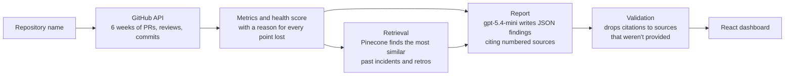
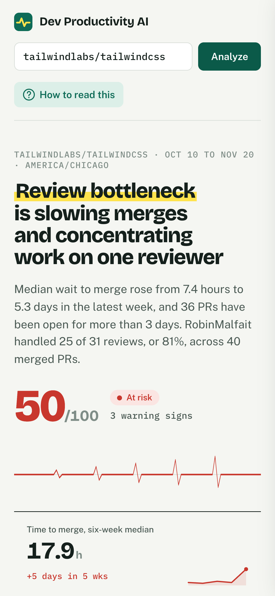

# Dev Productivity AI

Engineering teams rarely see trouble coming. Code waits days for review, one person quietly ends up reviewing everything, and the first anyone hears of it is a missed deadline or a burned-out teammate.

Dev Productivity AI reads a GitHub repository's last six weeks, finds those warning signs, and writes a short weekly report on what to do about them, with every recommendation linked to the past incident or retrospective it came from.

**Try it:** [dev-productivity-ai.vercel.app](https://dev-productivity-ai.vercel.app). Enter any public repository, for example `tailwindlabs/tailwindcss`.


---

## What it found in a real project

Analysis of `tailwindlabs/tailwindcss`, six weeks ending November 20, 2026:

- The typical wait to merge a pull request rose from **7.4 hours to 5.3 days** in the latest week.
- **36 pull requests** had been open for more than three days.
- **One maintainer did 25 of the last 31 reviews (81%).**

That combination, slow merges plus one overloaded reviewer, is the pattern the tool exists to catch. The report recommended spreading reviews across more people and setting a 24-hour review target, and cited the past incident each step came from:


Numbers like these change every week, and the live site always shows the current ones.

---

## How it works



1. **Collect.** The FastAPI backend pulls six weeks of pull requests, commits and the reviews on recently merged PRs from the GitHub API, leaving out bots. The six weeks are aligned to the visitor's own time zone, so a PR merged at 7:30pm on October 11 in Oklahoma lands in the same week the visitor sees on GitHub.
2. **Measure.** It calculates the median time from opening a PR to merging it, week by week; how many PRs have been open for more than three days; and how concentrated reviews and commits are.
3. **Score.** The score starts at 100 and loses points for each warning sign. Every deduction comes with a plain-language reason, so the score is never a black box.

   | Warning sign | Points |
   |---|---|
   | Typical wait over 24 hours / 2 days / a week | -12 / -25 / -35 |
   | Waits have doubled over recent weeks | -10 |
   | 2-4 / 5+ PRs open for more than 3 days | -8 / -15 |
   | One person does over 50% / 70% of reviews | -12 / -25 |
   | One person makes over 80% of commits | -10 |

   Solo projects aren't penalized for having one person do everything. Projects with very little activity are labelled "too little activity" instead of getting a misleading score, and projects that switch pull requests off, like the Linux kernel, are judged on commits alone.
4. **Retrieve.** The warning signs are embedded and searched against a Pinecone index of past incident reports and sprint retrospectives. Each match comes back with a similarity score that's shown to the user.
5. **Generate.** The metrics, the reasons and the retrieved documents go to `gpt-5.4-mini`, which returns JSON: a headline, up to two risks, up to two actions and one thing going well, each citing numbered sources. The model is told to use only the numbers it's given.
6. **Validate.** The response is checked against the expected shape, and any citation pointing to a source that wasn't provided is removed before it reaches the page.
7. **Trace.** Every analysis is recorded in Langfuse as one trace: the history search, the embedding call and the report generation, each with its latency, token counts and cost, plus the final health score.

A "How to read this" panel in the app explains every number, chart and label in plain language. The layout also works on phones.

<p>
  
  
</p>

---

## Engineering decisions

| Decision | Why |
|---|---|
| Structured JSON reports instead of free text | The dashboard can render findings by type, and citations can be checked in code |
| A reason for every point deducted | Managers can see why the score moved, and disagree with it if they want |
| Time zone sent by the browser | Mixing UTC and local time moved PRs into the wrong week during testing |
| One-hour cache, a per-visitor hourly limit and a site-wide daily cap | Keeps API costs predictable on a public demo. Langfuse measures a report at about $0.0025 |
| Langfuse tracing, switched off when keys are absent | Latency, tokens and cost per step are visible in production, while CI and fresh checkouts run without it |
| Exact library versions in `requirements.txt` | An unpinned dependency update is what originally broke the live site |
| Read-only GitHub token scoped to public repositories | The least access the job needs |
| A scheduled health check every 10 minutes | Keeps the free Render server from sleeping, so visitors don't wait a minute for it to wake |

---

## Quality checks

Every push runs two checks in GitHub Actions:

- **Scoring tests** (`tests/test_metrics.py`) check the health score math on hand-built data with no API calls: solo projects, overloaded reviewers, duplicate reviews, quiet repositories and repositories without pull requests.
- **Report evaluation** (`tests/test_evaluation.py`) generates reports for a golden dataset of team scenarios and checks that each has a headline and the required finding types, raises no risks for a healthy team, cites only sources that exist, and mentions the key topic. The build fails below an 80% pass rate.

Before going live, the pipeline was also tested against twelve real projects, including `microsoft/vscode`, `facebook/react`, `django/django`, `torvalds/linux` and an archived repository. That testing found and fixed two bugs: repositories without pull requests were reported as missing, and nearly empty repositories scored a perfect 100.

---

## Tech stack

| Layer | Technology |
|---|---|
| Frontend | React and TypeScript, hand-drawn SVG charts, hosted on Vercel |
| Backend | Python 3.12, FastAPI, hosted on Render |
| Data | GitHub REST API |
| Retrieval | Pinecone serverless index, OpenAI `text-embedding-ada-002` embeddings, LangChain document loading and splitting |
| Generation | OpenAI `gpt-5.4-mini` with JSON output |
| Observability | Langfuse traces for each report (retrieval, embedding and generation steps) |
| CI | GitHub Actions: scoring tests, report evaluation, and the keep-awake job |

---

## Current limitations

These are honest gaps, and the next things on the roadmap.

- **The incident library is a sample.** It holds two example documents, an incident report and a sprint retrospective, about a fictional team. Every repository is compared with the same two, and the dashboard says so. Letting each team upload its own history is the next major feature.
- **No stored history.** Each analysis covers six weeks fetched live, so there are no month-over-month trends yet.
- **Sampling on busy repositories.** At most 300 PRs and 300 commits are read, and reviews are checked on the 40 most recently merged PRs.
- **Public repositories only.** Private repositories would need a GitHub App with read-only, per-repository access, plus login and per-company data separation.

## Roadmap

- [ ] Teams upload their own incident reports and retrospectives, stored in a separate Pinecone namespace per team
- [ ] Store weekly snapshots in Postgres, collected by a nightly job, for long-term trends
- [ ] More signals: cycle time from first commit, time to first review, code churn, files with repeated bug fixes, after-hours work in each contributor's time zone
- [x] Langfuse tracing for latency, tokens and cost per report
- [ ] A second model that checks each cited source actually supports the claim
- [ ] A weekly email report for managers

---

## Run it yourself

You'll need Python 3.12, Node 18 or newer, and API keys for OpenAI and Pinecone, plus a GitHub token with read-only access to public repositories.

```bash
git clone https://github.com/ttabirami12062/dev-productivity-ai
cd dev-productivity-ai

# Backend
python3.12 -m venv .venv
.venv/bin/pip install -r requirements.txt
cp .env.example .env          # then fill in your keys
.venv/bin/python -m src.rag_pipeline   # builds the Pinecone index from documents/
.venv/bin/uvicorn api:app --port 8000

# Frontend, in a second terminal
cd frontend
npm install
REACT_APP_API_URL=http://localhost:8000 npm start
```

To analyze a repository from the terminal instead: `.venv/bin/python main.py owner/name`

Run the checks with `.venv/bin/python tests/test_metrics.py` (no keys needed) and `.venv/bin/python tests/test_evaluation.py`.

## Project structure

```
dev-productivity-ai/
├── api.py                    # FastAPI app: /analyze, /review, /health, caching and limits
├── main.py                   # Same analysis from the command line
├── src/
│   ├── github_client.py      # Fetches six weeks of PRs, commits and reviews
│   ├── metrics.py            # Metrics, health score and the reason for each deduction
│   ├── rag_pipeline.py       # Builds and searches the Pinecone index
│   ├── report_generator.py   # Prompt, JSON report and citation checks
│   └── observability.py      # Langfuse tracing (off when keys are missing)
├── documents/                # Sample incident report and retrospective
├── tests/                    # Scoring tests, golden dataset and report evaluation
├── frontend/                 # React and TypeScript dashboard
├── docs/screenshots/
└── .github/workflows/        # Quality checks and the keep-awake job
```

---

Built by **Abirami Thiyagarajan**, MS Computer Science, University of Oklahoma. I'm looking for full-time software engineering and AI/ML roles in the US, and I'd love to hear from you if you lead an engineering team or are working on something similar.

[GitHub](https://github.com/ttabirami12062) · [LinkedIn](https://linkedin.com/in/abirami-thiyagarajan)
